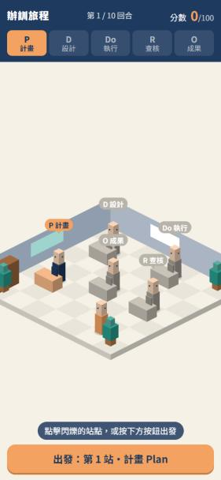
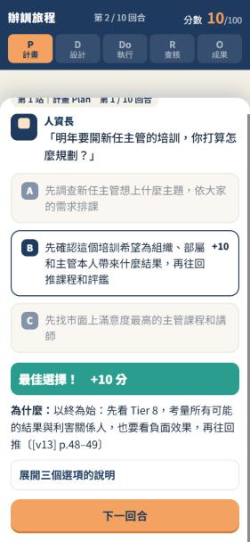
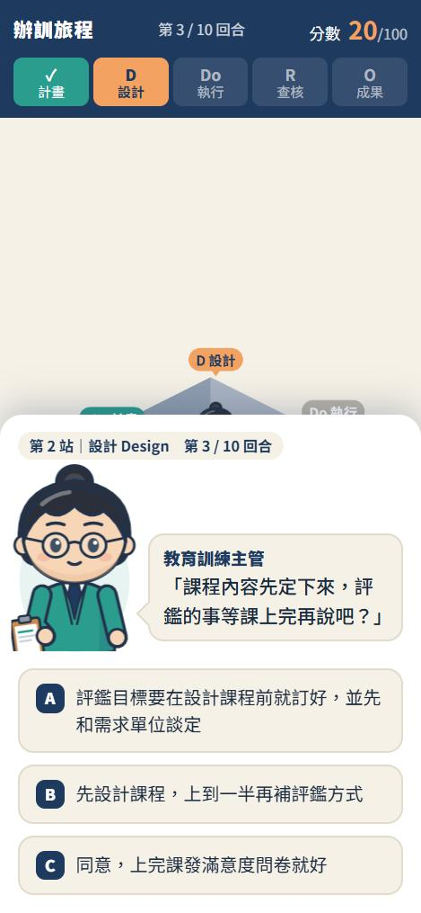
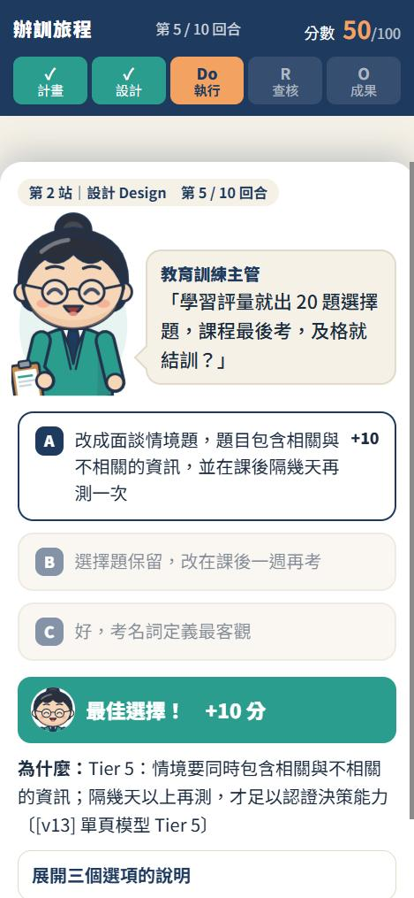

# 02｜Character Redesign POC 驗收報告

分支：`redesign-poc`（正式版 `main` 與線上網址未變動）
範圍：主角＋1 位 NPC（教育訓練主管，第 3、5、8 回合）

## 1. 修改檔案清單

| 檔案 | 類型 | 內容 |
|---|---|---|
| `characters.js` | 新增 | 角色視覺系統：共用美術規範、角色定義、role→角色對應、表情規則、SVG 產生、地圖 sprite 快取 |
| `iso.js` | 修改 | 新增 `actor()` 以圖像繪製地圖人物（失敗退回原方塊人）；NPC 待機微動；完成站點 NPC 變開心；玩家往左走時鏡像；站點標籤上移 |
| `game.js` | 修改 | 新增 `setPortrait()`；`openRound()` 顯示開場表情立繪；`choose()` 作答後切換表情並在回饋列顯示小頭像；`renderHud()` 傳入各站 NPC；啟動時預載角色圖 |
| `index.html` | 修改 | 對話區加入立繪容器、對話泡泡、回饋列小頭像；載入 `characters.js` |
| `style.css` | 修改 | 立繪與泡泡版面、進場／換表情／呼吸動畫、`prefers-reduced-motion` 關閉動畫 |
| `docs/redesign/*` | 新增 | As-Is 盤點、角色設計定稿表、本報告、前後截圖 |

**未修改**：`rounds.json`、`config.js`、`host.html`、`apps-script/Code.gs`、計分、存檔格式、上傳格式。

## 2. 技術變更摘要

- 角色依 `rounds.json` 的 `role` 字串對應（`教育訓練主管 → trainingManager`），未對應的角色自動沿用原本的方塊造型與色塊頭像，因此 POC 可以和未改版角色並存。
- 地圖人物：向量角色先點陣化成「顯示高度 × 裝置像素比」的離屏 canvas 並快取，每幀只做 `drawImage`，不會重複解析 SVG 或重複建立圖片。
- 表情：開場依台詞情境（第 5 回合「思考」、第 8 回合「驚訝」），作答後依回饋內容（最佳→開心、部分正確→思考、常見陷阱→驚訝），規則集中在 `characters.js`，可逐回合覆寫。表情只是輔助，文字回饋仍完整保留。
- 角色圖全部內嵌在 JS（`characters.js` 含程式約 12 KB），沒有新增網路請求或外部服務。

## 3. 修改前後比較（手機 375×812）

| | 修改前 | 修改後 |
|---|---|---|
| 地圖 |  |  |
| 對話 |  |  |
| 作答後 | （無角色反應） |  |

## 4. 已完成測試

| 項目 | 結果 |
|---|---|
| 10 回合完整遊玩（混合答案） | ✅ 總分 65 = 預期 65，結局「穩健的辦訓者」 |
| 存檔格式 | ✅ sessionStorage 欄位與改版前相同（nick, startAt, answers[{opt,score}], finished, uploaded, endAt） |
| 開場表情 | ✅ 第 5 回合思考、第 8 回合驚訝 |
| 作答後表情 | ✅ 第 3 回合陷阱→驚訝、第 5 回合部分正確→思考、第 8 回合最佳→開心 |
| 未設計角色退回原造型 | ✅ 第 1、2、4、6、7、9、10 回合正常顯示原色塊頭像 |
| Console 錯誤 | ✅ 無 |
| 360×640、375×812 版面 | ✅ 無橫向捲動，立繪不遮擋題目 |
| 減少動態效果 | ✅ CSS 與地圖待機動畫皆依 `prefers-reduced-motion` 關閉（程式檢查，未在實機切換測試） |

## 5. 未完成／需人工確認

1. **iPhone Safari、Android Chrome 實機測試**：需要把 POC 放到網路上才能用手機掃碼（尚未部署，等你同意）。
2. **畫風決策**：程式繪製的扁平向量風是否符合期待（見 `design-sheet.html`）。
3. **成績上傳**：本分支未改動上傳程式；後台尚未設定，無法驗證實際寫入。
4. **已知限制**：同一站換人時（第 2、4、7 回合），桌前人物與對話立繪不同，因為地圖每桌只站一位角色。
5. **發現的既有問題（未修正，依規格先回報）**：作答完一站最後一回合後、按「完成本站」之前，上方 PDDRO 進度條就已經跳到下一站。這是原版 `renderHud()` 依作答數計算站點造成的，屬視覺小瑕疵，不影響計分。

## 6. 後續全面改版建議

1. 定版畫風後，依同一骨架擴充其餘 5 位 NPC：人資長、需求單位主管、外部講師、外部訓練單位窗口、受訓學員（每位約 1 小時，含表情檢查）。
2. 換人回合讓第二位角色走到桌前，或在桌邊多放一個位置。
3. 結局畫面加入主角完成任務的開心立繪。
4. 若要改成手繪厚塗風，以 `design-sheet.html` 為規範委外繪製，前端只需把 `characters.js` 的圖源換成 WebP 路徑。
